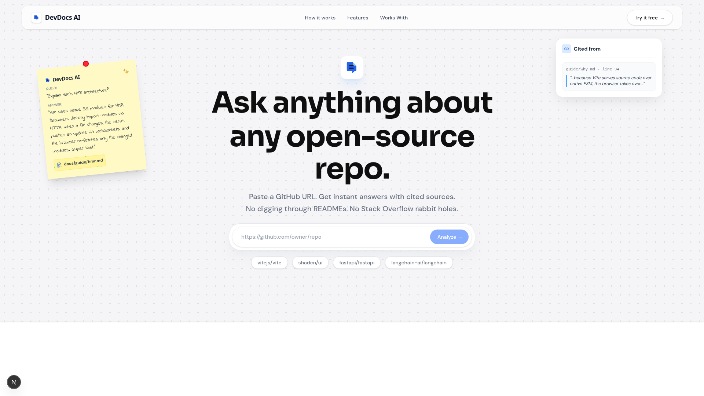
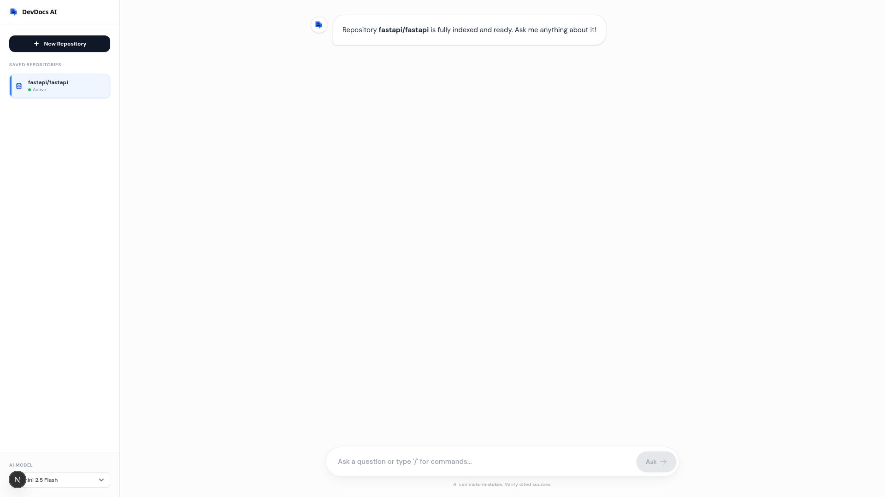

# DevDocs AI

DevDocs AI turns a public GitHub repository into a source-aware documentation assistant. Submit a repository, let the ingestion pipeline index its documentation, then ask questions and inspect the cited source files.

## Product preview

| Landing page | Chat workspace |
| --- | --- |
|  |  |

## Features

- Repository documentation crawling and budget-capped OpenAI embeddings
- Retrieval-augmented chat with streamed answers and source links
- Persistent ChromaDB vector storage
- Production-mode local stack managed by Docker Compose

## Run locally with Docker Compose

Requirements: Docker Engine with the Compose plugin, and an OpenAI API key.

```bash
cp .env.example .env
```

Add your key to `.env` as `OPENAI_API_KEY=...` for repository ingestion, retrieval embeddings, and generated chat answers, then start the production containers:

```bash
docker compose up --build
```

Compose waits for ChromaDB and the API to become healthy before starting the frontend. Open [http://localhost:3000](http://localhost:3000). The API is proxied internally by Next.js; interactive API documentation is available at [http://localhost:3000/api/docs](http://localhost:3000/api/docs).

Chroma data is stored in the named `chroma_data` volume and survives container restarts. Stop the services with `Ctrl+C` or `docker compose down`; do not add `--volumes` if you want to retain indexed repositories. To inspect service status and logs:

```bash
docker compose ps
docker compose logs -f frontend backend chroma
```

Repository ingestion and retrieval use OpenAI `text-embedding-3-small`. The app enforces a persistent **$0.50 lifetime cap** for embedding usage across ingestion and chat-query embeddings, including concurrent requests; batches are token-counted and reserved before being sent. Successful requests settle to provider-reported usage, and ambiguous failures remain reserved to avoid overspending. At the current $0.02 per million input tokens, the cap corresponds to 25 million tokens. See `/api/v1/embedding-budget` for the remaining allowance. This cap covers embeddings through this app, not chat-completion charges or other apps using the same OpenAI account. The key is read only by the backend and must never use a `NEXT_PUBLIC_` variable.

If host port `3000` is already in use, set `FRONTEND_PORT=3001` in `.env` and open `http://localhost:3001` instead.

## Development setup

For frontend/backend development outside containers:

```bash
npm ci
python3 -m venv .venv
source .venv/bin/activate
pip install -r backend/requirements.txt
npm run dev
```

The frontend runs at `http://localhost:3000` and the API at `http://localhost:8000`. Set `OPENAI_API_KEY` in `.env`; the backend uses local persistent Chroma storage unless `CHROMA_HOST` is configured.

## Architecture

```text
Browser → Next.js frontend → FastAPI API → OpenAI embeddings → ChromaDB
                                      ├── GitHub tree and raw-content APIs
                                      └── OpenAI chat generation
```

In Compose, Next.js proxies `/api/*` to FastAPI over the private service network. FastAPI connects to the ChromaDB HTTP server. The OpenAI key remains server-side.

## Configuration

| Variable | Service | Purpose |
| --- | --- | --- |
| `OPENAI_API_KEY` | Backend | Required for repository embeddings and generated chat answers; never exposed to the browser |
| `OPENAI_MODEL` | Backend | Chat model; defaults to `gpt-6-luna` |
| `EMBEDDING_BATCH_SIZE` | Backend | Embedding request batch size; defaults to `32` |
| `NEXT_PUBLIC_API_URL` | Frontend | Optional public backend URL for a separately hosted frontend |
| `CHROMA_HOST`, `CHROMA_PORT` | Backend | Optional Chroma HTTP server; unset uses local persistent storage |

Compose stores the embedding budget ledger in the persistent `embedding_budget_data` volume. Do not remove that volume or its database if you need the $0.50 cap to remain cumulative across restarts. Never commit `.env` or expose the OpenAI key in browser code. For hosted deployments, configure secrets and persistent budget storage in the hosting provider rather than the repository.

## Deployment

The Compose setup is for a self-contained local production-mode stack. The existing Vercel setup deploys the Next.js frontend only and still requires a separately hosted FastAPI/Chroma backend; configure `NEXT_PUBLIC_API_URL` with that backend’s public HTTPS origin. See [deployment guide](docs/deployment.md).

## Documentation

- [Architecture](docs/architecture.md) · [API reference](docs/api.md) · [Backend guide](docs/backend.md)
- [Frontend guide](docs/frontend.md) · [RAG pipeline](docs/rag-pipeline.md) · [Deployment](docs/deployment.md)

## Quality checks

```bash
npm run typecheck
npm run lint
npm run build
```
